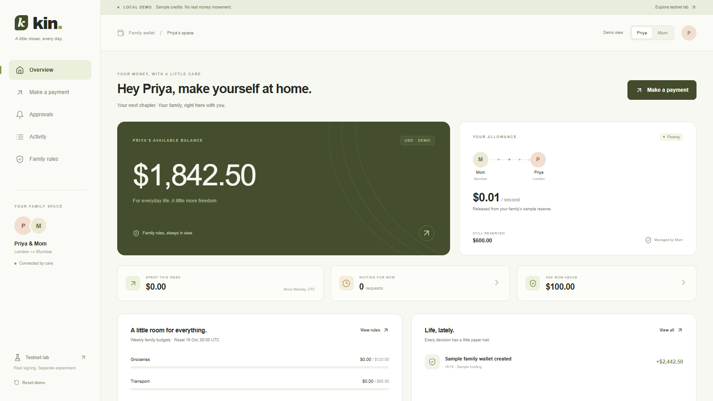
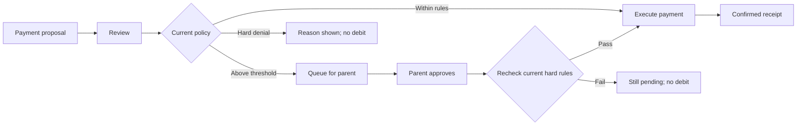

# Kin

**Money with guardrails for families living apart.**

[Open Kin](https://kin-metropolis.vercel.app/) · [Watch the demo · 2:59](https://kin-metropolis.vercel.app/demo.html) · [Watch the pitch · 1:27](https://kin-metropolis.vercel.app/pitch.html) · [Source](https://github.com/Pradhyut21/Kin)

A transfer answers “did the money arrive?” Kin answers what comes next: **what can I spend now, what needs a conversation, and why was a payment declined?**

Kin releases a prepaid allowance over time. Everyday payments follow clear rules. Larger purchases ask the funding parent. Approval grants an exception to the soft threshold and still faces the **current** recipient binding, blocklist, budgets and available allowance.

Built for **Metropolis · Consumer Products & Payments** on Monad.



*Consumer walkthrough: sample credits and demo roles. The separate Monad lab records actual test-token transactions.*

## The moment that matters

Queue a valid purchase. Tighten its hard cap while the request waits. Now approve it.

Kin rejects the approval, deducts nothing and keeps the request pending. Restore a sufficient cap and the same request can execute once. This behavior is demonstrated in the consumer flow and exercised against the deployed contracts.



The student consents to the chosen funding parent. The parent can change rules or pause the stream; a pause freezes spending and accrual while preserving earned entitlement. Kin offers room to act within an explicit funding arrangement.

## Working proof on Monad Testnet

The contracts are deployed and wired on **Monad Testnet, chain 10143**, using official Agora testnet **AUSD, 6 decimals**. The browser lab recorded these genuine transactions:

| Recorded interaction | Public receipt |
| --- | --- |
| Pay 1 test AUSD to a registered grocery recipient | [Confirmed payment](https://testnet.monadscan.com/tx/0xea1b92088740a890395f83c38786e372563fd8a283da476b97f5ec795f179162) |
| Request 10 test AUSD; no token transfer while queued | [Confirmed request](https://testnet.monadscan.com/tx/0xfb09818f6e935af484fb4f1c7cedd7a1d591bb9a1f0f8ad4019e6b763625246b) |
| Recorded parent approves; 10 test AUSD transfers | [Confirmed execution](https://testnet.monadscan.com/tx/0xf7684a36416f75a7cf73631018837a7194f217e1e0a971dc09523d0de7fd6e4e) |

Public-RPC readback checked senders, chain, successful receipts and token/event effects. At block **70411769**, the vault held **77 test AUSD**, request 2 was approved/executed, and no requests were pending. This is a historical block snapshot.

Tightened-cap approval and blocked-recipient execution returned `SpendDenied(6)` and `SpendDenied(5)` in **read-only `eth_call` simulations**. Neither was presented as a broadcast transaction. Replaying the resolved request returned `RequestAlreadyExecuted`.

| Contract | Deployed address |
| --- | --- |
| StreamVault | [0xf2137f65917308311AAAb0F9910c7dc7D01fBDa3](https://testnet.monadscan.com/address/0xf2137f65917308311AAAb0F9910c7dc7D01fBDa3) |
| PolicyModule | [0x07A3d10E739A646894855bCd68A9CB2266594034](https://testnet.monadscan.com/address/0x07A3d10E739A646894855bCd68A9CB2266594034) |
| ApprovalQueue | [0xB63990eB933cbd6688595d0bC440f7BE7AFfC1AF](https://testnet.monadscan.com/address/0xB63990eB933cbd6688595d0bC440f7BE7AFfC1AF) |

[Deployment and wiring](contracts/deployments/monad-testnet.json) · [Complete setup and policy proof](submission/REAL_TESTNET_DEMO_EVIDENCE.json) · [Recorded receipt/event verification](submission/TESTNET_VIDEO_RECEIPT_EVIDENCE.json)

Explorer source verification is not claimed. The recording used a visibly labeled disposable TEST wallet bridge, with keys outside the browser. The temporary bridge and keys are excluded from this repository; it was stopped after recording. No wallet-extension confirmation modal or passkey authentication is claimed for that recording.

## Run it locally

Requires **Node.js 22.18+**. From the repository root:

```sh
npm run setup
npm run dev
```

Open the URL printed by Vite and choose **Explore demo**. The consumer sample-credit walkthrough needs no wallet, backend or API credentials. Priya/Mom switching illustrates two perspectives and is not authentication. Retailer names are sample recipients. On Windows PowerShell, use `npm.cmd` if execution policy blocks `npm`.

For the separate real-contract lab, copy `frontend/.env.example` to your ignored `frontend/.env.local`, add the public values below, and restart Vite:

```dotenv
VITE_STREAM_VAULT_ADDRESS=0xf2137f65917308311AAAb0F9910c7dc7D01fBDa3
VITE_POLICY_MODULE_ADDRESS=0x07A3d10E739A646894855bCd68A9CB2266594034
VITE_APPROVAL_QUEUE_ADDRESS=0xB63990eB933cbd6688595d0bC440f7BE7AFfC1AF
VITE_MONAD_RPC_URL=https://testnet-rpc.monad.xyz
```

Open **Testnet lab** and connect your own disposable Monad Testnet wallet. The lab verifies code, token identity and wiring before enabling writes. A different wallet does not control the recorded family stream; create a new consented stream with your own test roles. Follow [the contract guide](contracts/README.md) and use test assets only.

The recorded stream used **100 test AUSD at an accelerated 0.5 AUSD/second rate** for a short demonstration.

## Implementation and validation

`StreamVault` escrows one supported token and computes earned entitlement from elapsed time. `PolicyModule` binds categories to parent-registered receiving addresses. `ApprovalQueue` authenticates the recorded parent and makes requests single-use with a 48-hour expiry. Pending requests do not reserve funds; per-second availability needs no transaction every second.

The embedded language parser is deterministic. Optional backend model output is an untrusted proposal for review, with no keys or spending/rule-edit authority. Unconfigured integrations remain unavailable.

```sh
npm run check
```

This builds frontend/backend and runs frontend, API, local-EVM contract and indexer-accounting checks. The contract suite covers 32 regression groups, including 50 deterministic accrual/property cases. Browser acceptance uses a running dev server and Microsoft Edge; see the package scripts.

## Prototype scope

Consumer sample credits and real testnet signing are separate. Recipient registration is an address/category rule, not verification of purchased goods. There is no bank payout, live FX, retail acceptance, unrestricted withdrawal, refund/recovery, reviewed passkey/Mera account, independent security audit or tested market demand. The Envio code is a disabled scaffold; the raw-P256 account experiment is excluded from deployment. Family relationships and payment metadata can become public onchain. Read [SECURITY.md](SECURITY.md).

[Application text](submission/SUBMISSION_COPY_READY.txt) · [Evidence overview](SUBMISSION.md) · [Independent AI critique](submission/AI_JUDGE_REVIEW.md)

Pilots, consumer wallet onboarding, recovery, privacy review and sponsor-bounty qualification remain future work.
